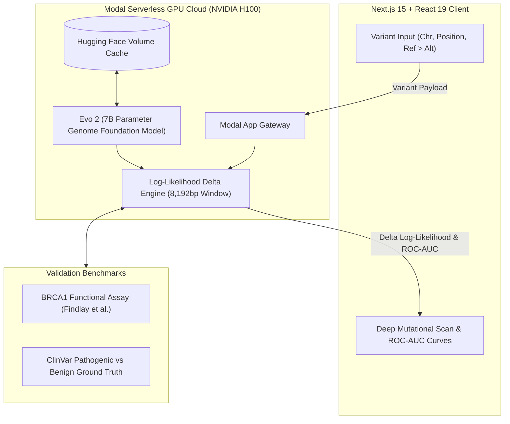

# 🧬 GeneLabs: AI Genomic Variant Analysis Platform

[-8A2BE2)](https://github.com/ArcInstitute/evo2)
[](https://nextjs.org)
[](https://react.dev)
[](https://www.typescriptlang.org)
[](https://python.org)
[](https://modal.com)
[](https://developer.nvidia.com/cuda-toolkit)
[](LICENSE)

An end-to-end, high-throughput AI genomic variant analysis platform powered by **Arc Institute's Evo 2** (7-billion parameter DNA foundation model). GeneLabs delivers zero-shot pathogenicity predictions, deep mutational scanning (DMS), and ClinVar-calibrated functional impact scoring across human genomic loci.

---

## 🔬 Scientific Architecture & Model Pipeline

GeneLabs couples a reactive Next.js 15 interface with a serverless **NVIDIA H100 GPU** backend managed via **Modal**:



### 🧬 Zero-Shot Variant Effect Scoring
For any single nucleotide variant (SNV) or indel:
1. **Context Window Extraction**: Extracts an $8,192\text{ bp}$ genomic sequence centered on the target coordinate ($[P - 4096, P + 4096]$).
2. **Wild-Type vs Mutant Evaluation**: Computes the forward log-likelihood under Evo 2 for both reference $\mathcal{S}_{\text{ref}}$ and mutant sequence $\mathcal{S}_{\text{alt}}$.
3. **Fitness Delta Scoring**:
   $$\Delta \log \mathcal{L} = \sum_{i=1}^{L} \log P(\mathcal{S}_{\text{alt}, i}) - \log P(\mathcal{S}_{\text{ref}, i})$$
   Negative deltas indicate severe evolutionary fitness disruption and high pathogenicity probability.

---

## ✨ Key Features & Clinical Benchmarks

* **🎯 Deep Mutational Scanning (DMS)**: Pre-calibrated against experimental *BRCA1* saturation genome editing assays (*Findlay et al., Nature*).
* **📈 ROC-AUC Validation**: Calculates Receiver Operating Characteristic curves and Area Under Curve (AUC) metrics discriminating pathogenic from benign ClinVar variants.
* **⚡ Serverless NVIDIA H100 Scaling**: Runs on on-demand H100 Tensor Core GPUs with Transformer Engine v1.13 and FP8/BF16 mixed precision.
* **🖥️ Modern Genomic Locus Explorer**: Next.js 15 App Router with Turbopack, Tailwind CSS v4, Lucide icons, and Radix UI accessible primitives.

---

## 🗂️ Project Organization

```
genelabs/
└── variant-analysis-evo2-main/
    ├── evo2-backend/           # Modal Serverless GPU Backend
    │   ├── main.py             # Modal application, H100 deployment & BRCA1 pipeline
    │   ├── requirements.txt    # Modal dependencies
    │   └── evo2/               # Evo 2 model submodules & inference architecture
    └── evo2-frontend/          # Next.js 15 Web Application
        ├── src/
        │   ├── app/            # Next.js App Router (pages, layout, globals)
        │   ├── components/     # UI components, tabs, form controls
        │   └── lib/            # Utility helpers, styling wrappers
        ├── package.json        # Frontend dependencies & scripts
        └── tsconfig.json       # TypeScript compiler settings
```

---

## 🚀 Quick Start & Deployment Guide

### Prerequisites
* **Python**: v3.12
* **Node.js**: v20.x or newer
* **Modal Account**: For serverless GPU inference ([modal.com](https://modal.com))
* **Hugging Face Token**: Access to Evo 2 weights (`evo2_7b`)

### 1. Backend Setup & Modal Deployment

1. Navigate to the backend directory:
   ```bash
   cd variant-analysis-evo2-main/evo2-backend
   ```

2. Install Modal client:
   ```bash
   pip install modal
   modal setup
   ```

3. Deploy or run the H100 function interactively:
   ```bash
   modal run main.py::run_brca1_analysis
   ```

### 2. Frontend Development Server

1. Navigate to the frontend directory:
   ```bash
   cd variant-analysis-evo2-main/evo2-frontend
   ```

2. Install dependencies:
   ```bash
   npm install
   ```

3. Launch the development server:
   ```bash
   npm run dev
   ```
   Open [http://localhost:3000](http://localhost:3000) to inspect variant predictions.

---

## 📜 Citations & Acknowledgments

* **Evo 2 Foundation Model**: Developed by [Arc Institute](https://arcinstitute.org).
* **BRCA1 Validation Data**: *Findlay et al., "Accurate classification of BRCA1 variants with saturation genome editing", Nature (2018)*.

Developed by **Shaik Mohammed Ehtesham** ([@kaizxark](https://github.com/kaizxark)) under the **MIT License**.
